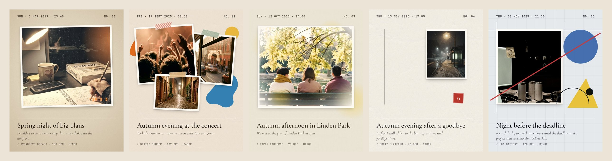

# Afterimage

**Genesis Hackathon · кейс ARTTech «Make the Invisible Visible»**

Прототип: https://after-image-sepia.vercel.app/ · Код: этот репозиторий · Видео: _вставьте ссылку_

## Описание

**Afterimage** — личный дневник, который превращает день (текст, фотографии и песню) в страницу-воспоминание с атмосферой этого дня. Человек записывает, что случилось, добавляет фото и песню (ссылку или свой файл). Система по правилам собирает **страницу дня**: формат 4:5, своя палитра, обработка фото, фактура, композиция, ритм и голос. День ложится в **папку** с коротким названием из 3–7 слов, которое придумывает система. Его можно оставить или переименовать. Страницу можно **проиграть**: звучит песня или синтезированный по её темпу и ладу саундскейп, фотографии сменяются в ритм, а по желанию синтетический голос читает запись. Все дни собираются в **архив**, который читается как один дневник, страница за страницей.

**Визуальная система.** У каждой страницы одна и та же рамка: бумага 4:5 с одинаковыми полями, дата в левом верхнем углу и номер страницы в правом (моноширинный шрифт), под линией название папки и строка из дня (антиква Cormorant), фотографии вклеены как отпечатки с бумажной рамкой. Поэтому 5–7 дней подряд выглядят как дневник одного человека. С днём меняются палитра, обработка фото, фактура (холст, зерно, крафт, рисовая бумага, сетка), композиция, ритм смены кадров, движение и голос.

**Как вход становится выходом.** Правила (`src/lib/atmosphere.ts`) считают на устройстве четыре оси:

| Ось | Из чего | На что влияет |
|---|---|---|
| Темп (pace) | темп песни (BPM), энергия записи, жанр, слова «дедлайн», «концерт», «тихо», количество фото | выбор техники, скорость смены кадров, голос |
| Вес (weight) | мажор/минор, слова радости и грусти, погода, яркость звука | техника, насыщенность палитры, высота голоса |
| Свет (light) | доминирующие цвета фото, сезон, время суток, температура, слова | бумага и оттенки, тёплая или холодная обработка |
| Дистанция (distance) | возраст дня, год песни, слова о прошлом | старые дни и песни уходят в «плёнку» |

Музыка влияет на дизайн тремя способами. Темп задаёт ритм: каждый кадр держится заданное число долей (Моне 8, «ма» 12, плёнка 6, коллаж и Кандинский 4). Лад приглушает или осветляет палитру. Жанр и год могут сменить технику. Если человек прикрепил свой файл, приложение прямо в браузере измеряет BPM, энергию и яркость (`src/lib/audio.ts`, Web Audio API); файл никуда не отправляется. Голос — синтетический (Web Speech API): скорость, высота и паузы между предложениями берутся из тех же осей.

**Логика объяснима.** На странице каждого дня есть блок «Why the page looks like this»: техника, четыре шкалы и правила, которые сработали, простыми словами. Например: «“Low Battery” (128 bpm, minor key, electronic) sets the rhythm: a new photograph every 1.9 s». Тот же разбор показывается ещё до сохранения, на шаге «What we noticed», поэтому видно, как каждое поле меняет страницу. Правила описывают страницу, а не человека: никаких диагнозов.

## Художественные техники

| Техника | Когда | Как выглядит | Почему так |
|---|---|---|---|
| **Impressionist light**, по мотивам Клода Моне | спокойные, нежные, медленные дни | фото с мягкими краями, пятна света плывут по странице, тёплая обработка, долгие растворения | на странице нет жёстких краёв, взгляд отдыхает, как в тот день |
| **Geometric composition**, по мотивам Василия Кандинского | напряжённые, бессонные дни | холодная контрастная обработка, круги и линии поверх строгой сетки, жёсткие склейки в такт | у дня были грани и пульс, у страницы тоже |
| **Faded film print**, 35-мм снимки | дни старше нескольких лет, песни из другой эпохи | зерно, приподнятые тени, засветка, оранжевая дата в углу кадра, пожелтевшая бумага | так ощущаются старые фотографии: выцветшие, тёплые, чуть недосягаемые |
| **Cut-paper collage**, по мотивам вырезок Анри Матисса | яркие, шумные, людные дни | несколько фото на скотче под углом, вырезанные из цветной бумаги формы, насыщенный цвет, быстрые смены | насыщенный день наслаивается сам на себя |
| **Ma**, японское «пустое пространство» | тихие, одинокие, тяжёлые дни | одно маленькое фото в поле бумаги, тонкая линия, красная печать с числом дня, самые медленные растворения | пустота даёт чувству место, а не заполняет его |

Порядок правил: сначала время (старый день становится плёнкой), затем темп (Кандинский или коллаж), затем вес («ма»), иначе Моне. Формы и цвета нарисованы заново в коде (SVG и CSS). Это приёмы и настроение, а не копии конкретных работ.

## Пять примеров

Пять вымышленных дней одного человека, пять разных техник (картинки в `docs/days/`):

1. **Spring night of big plans** (3 марта 2019): семнадцать лет, ночь у стола, класс смеялся над мечтой. День старше 7 лет, поэтому плёнка.
2. **Autumn evening at the concert** (19 сентября 2025): трамвай, толпа, сорванный голос, инди-рок 132 BPM в мажоре. Коллаж.
3. **Autumn afternoon in Linden Park** (12 октября 2025): друзья, скамейка, листопад, камерный фолк 70 BPM. Моне.
4. **Autumn evening after a goodbye** (13 ноября 2025): подруга уезжает в Лиссабон, мокрый снег, эмбиент-пианино в миноре. «Ма».
5. **Night before the deadline** (20 ноября 2025): девять часов до сдачи, электроника 128 BPM в миноре. Кандинский.

## Как проверить

1. Откройте https://after-image-sepia.vercel.app/ → **Open the darkroom** → **Memories**. Пять дней показаны страницами (Pages) в одной рамке.
2. Откройте любой день: это папка дня. Нажмите **Play the day**: звучит музыка, кадры меняются в ритм песни. Включите **Read it aloud**, чтобы голос прочитал запись. Под страницей — объяснение.
3. Нажмите **New**. Напишите пару предложений, добавьте фото и песню (жанр, год, лад; можно приложить свой аудиофайл, его темп измерится на устройстве). На шаге **What we noticed** видно название папки и будущую технику с причинами. Сохраните и нажмите **See the day’s page**.
4. Чтобы проверить влияние входа, отредактируйте день (**Edit**). Например, у «Autumn afternoon in Linden Park» поставьте темп 140 bpm и минор: спокойная страница в духе Моне станет геометрией Кандинского. Объяснение под страницей изменится вместе с ней.

## Соответствие правилам кейса

- Все данные вымышленные: человек, друзья, группы и песни придуманы. Демо-фото сгенерированы для проекта.
- Песни не хранятся и не распространяются. Можно указать ссылку или приложить свою запись, которая остаётся только на устройстве пользователя. Демо-музыка синтезируется в браузере.
- Голос только синтетический (Web Speech API).
- Нет медицинских и психологических выводов: правила описывают, как выглядит страница.
- Современные работы не копируются: техники переданы приёмами, формы нарисованы заново.

## Инструменты

React 19, TypeScript, Vite · Web Audio API (саундскейп по темпу и ладу, анализ загруженного трека через OfflineAudioContext) · Web Speech API (голос) · Canvas 2D (доминирующие цвета фото) · CSS container queries, blend modes и маски (страница) · IndexedDB (всё хранится на устройстве) · Vitest и Playwright (тесты) · Vercel (хостинг и одна функция для необязательного рисования по тексту через Google Gemini и Pollinations) · демо-фото сгенерированы Nano Banana (Gemini) по промптам из `PHOTO_PROMPTS.md`, видео на лендинге сделаны в Veo 3.1 · код писался с помощью ИИ-ассистента Claude Code.

## План видео (до 3 минут)

1. **0:00–0:20.** Лендинг, одна фраза о проекте: «дневник, который превращает день в страницу с атмосферой этого дня».
2. **0:20–0:50.** Memories → Pages: пять дней, одна рамка, пять техник. Покажите, что дата, название и вклейка фото везде на одном месте.
3. **0:50–1:40.** Откройте «Night before the deadline» → Play the day (жёсткие склейки в такт 128 BPM) → затем «Autumn evening after a goodbye» с голосом (медленно, долгие растворения). Прокрутите блок «Why the page looks like this».
4. **1:40–2:40.** New: короткая запись, фото, песня со своим файлом (покажите «Heard on this device: … bpm»), шаг What we noticed (имя папки и превью техники), сохранить → See the day’s page.
5. **2:40–3:00.** Edit «Autumn afternoon in Linden Park»: темп 140 bpm и минор, и страница становится Кандинским. Финал на архиве.
